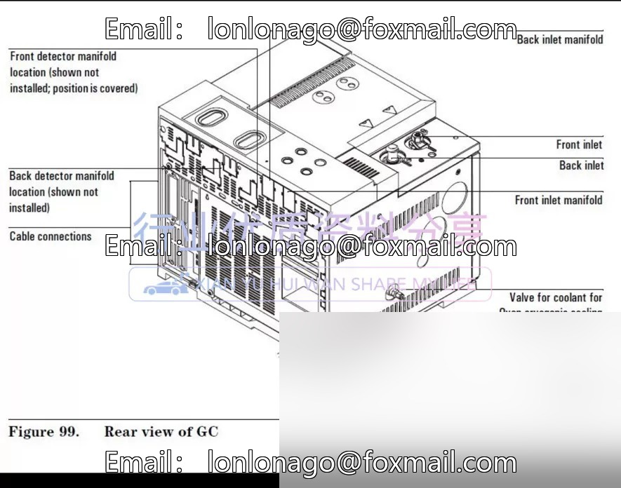
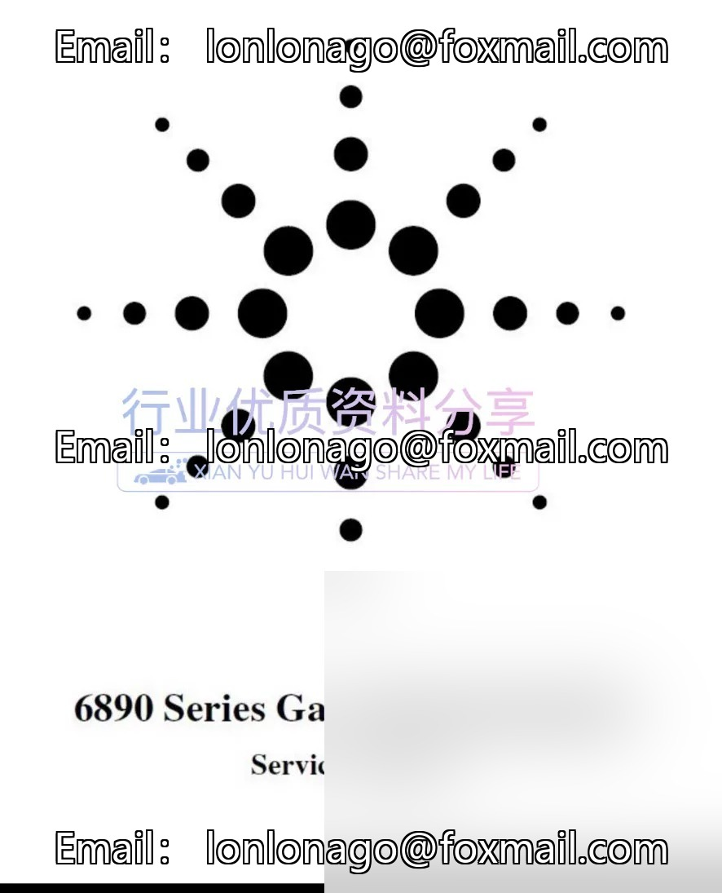
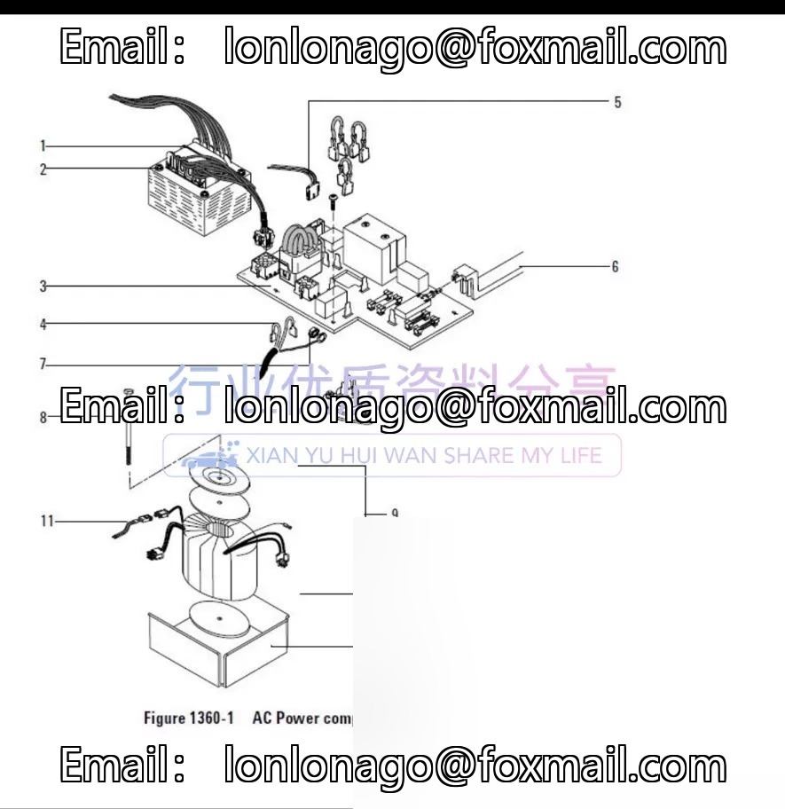
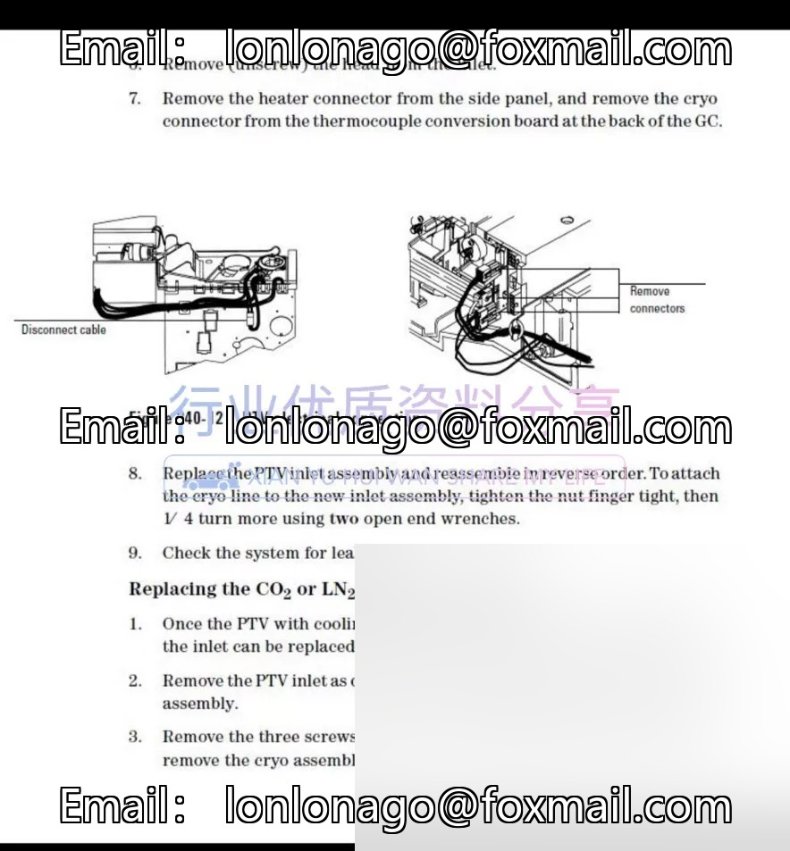
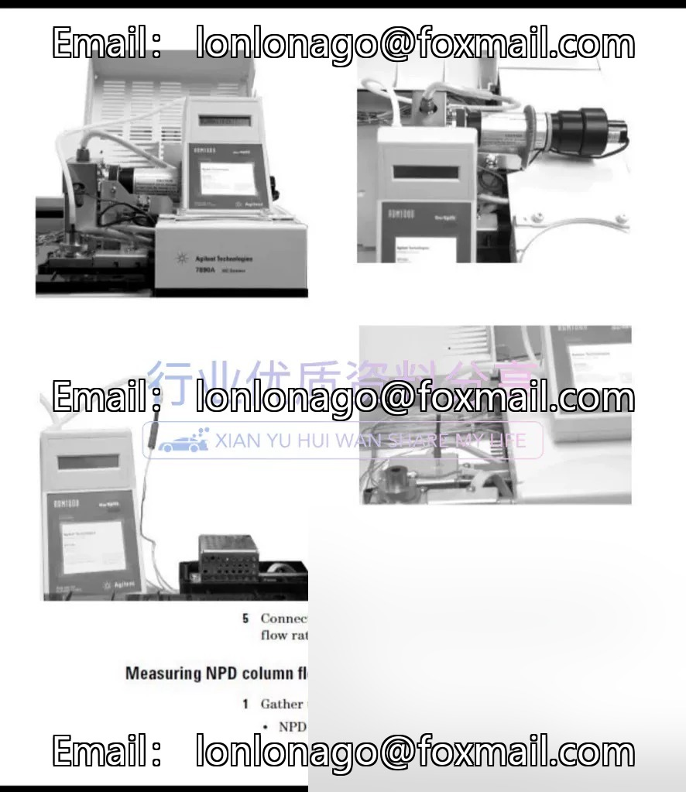
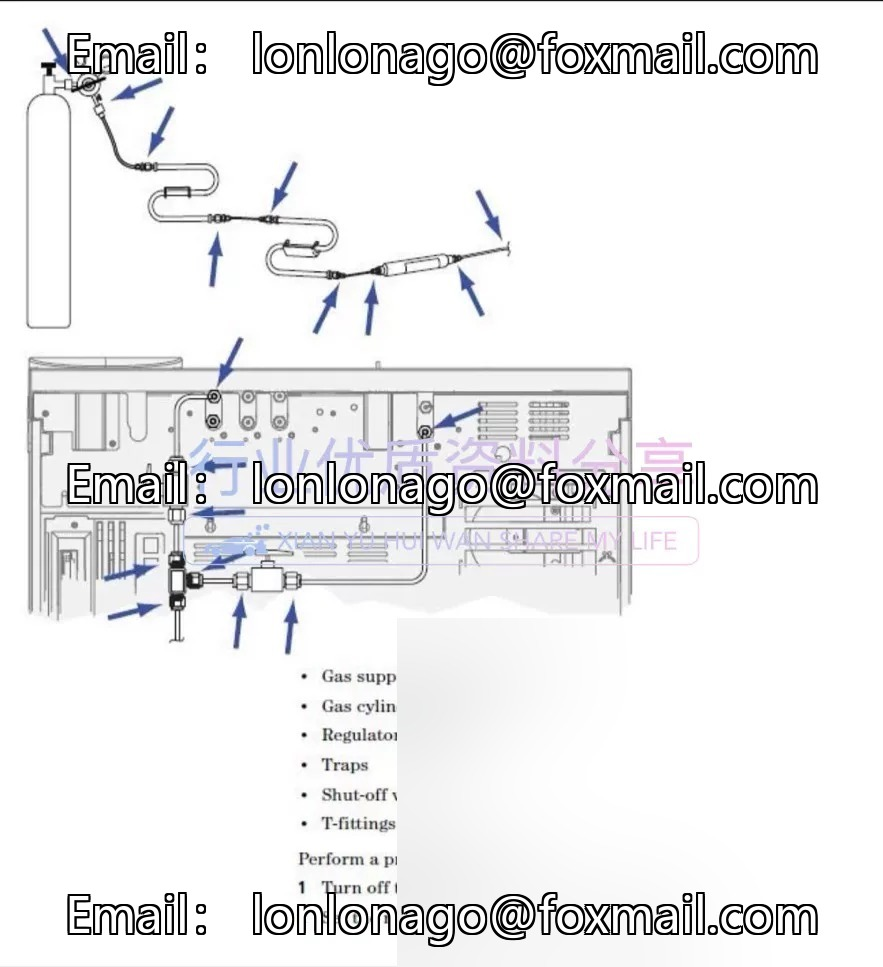

# #GC technical data of Agilent 6890 series gas chromatography instrument, including user manual

## Body

#Juaneng 6890 series gas chromatography instrument GC technical data, including user manual, maintenance service manual and fault exclusion manual, detailing instrument structure and principles, operation and maintenance methods, maintenance fault exclusion, part and material number list, etc., with detailed and high reference value.

Capture and send the electronic original directly! The following images include some file screenshots. Please confirm before placing the order! Due to the replicable nature of electronic documentation Therefore, after purchase, items cannot be returned! Thank you for understanding!

The materials cover Anharmony 6890 series gas chromatometer technical data, including user manuals, maintenance service manuals, troubleshooting guides, instrument structural principles, operation and maintenance methods, repair and fault resolution, and part number lists. The images show gas inlet and outlet manifolds, connections, valves, cables and repair steps.

<!-- AI_ENRICHED -->

## Images

## Payment

Here is a pay link on Stripe ( https://buy.stripe.com/3cs8yP7sY87d0vu9AB ). Please contact me lonlonago@foxmail.com after funding $89, and I will send you a complete data files , thank you!

